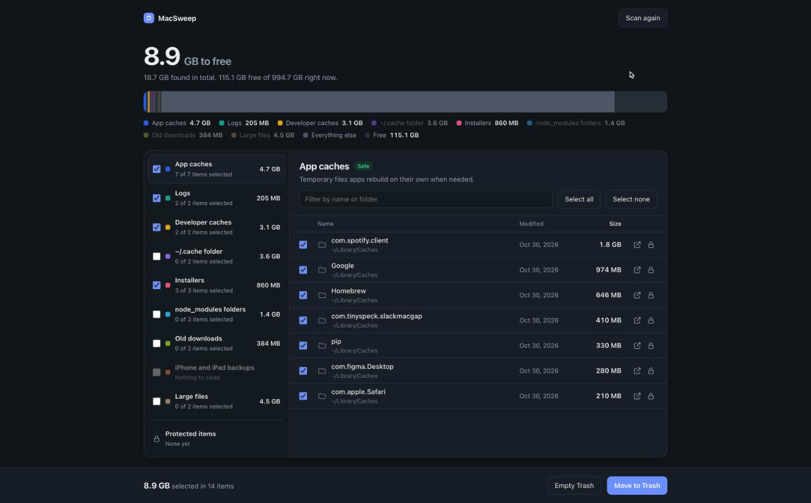
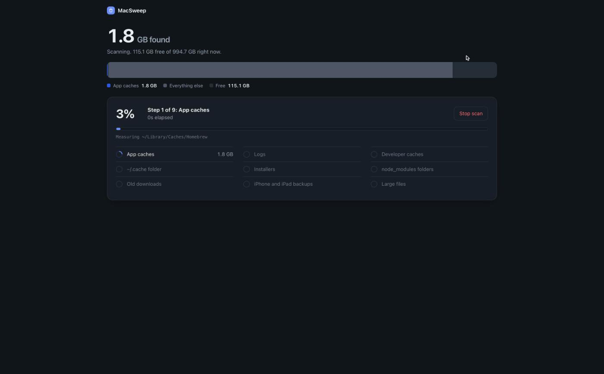

# MacSweep

Free up space on your Mac with a clean local app, or let any AI assistant do it for you through MCP.



- **You decide what goes.** Every item has a checkbox. Safe categories are preselected; anything that holds your own data starts unselected.
- **Nothing is deleted behind your back.** Items move to the Trash, so you can restore them until you empty it.
- **Keep things forever.** Click the lock on any item and MacSweep never offers it again, in the app or through MCP.
- **Works with AI assistants.** The built-in MCP server lets Claude, Cursor, ChatGPT or any MCP client scan and clean, with the same safety rules.
- **Local and dependency-free.** Pure Python standard library. No network calls, no telemetry, no account.

## What it checks

| Category | Risk | What it is |
|---|---|---|
| App caches | Safe | `~/Library/Caches`. Apps rebuild these on their own. |
| Logs | Safe | `~/Library/Logs`. Diagnostic history. |
| Developer caches | Safe | Xcode DerivedData and DeviceSupport, simulator caches, npm, pnpm, Gradle, Cargo. |
| Installers | Safe | `.dmg` and `.pkg` files in Downloads. |
| `~/.cache` folder | Review first | Tool and model downloads (Hugging Face, pip, Playwright…). |
| `node_modules` folders | Review first | Dependencies in your projects. `npm install` brings them back. |
| Old downloads | Review first | Items in Downloads not modified for 90 days. |
| iPhone and iPad backups | Review first | Local device backups made by Finder. |
| Large files | Review first | Files over 500 MB in your home folder, outside Library. |

MacSweep only looks inside your home folder. It never touches system files, and it never looks inside app bundles, Photos or Music libraries, or Git folders.

## Use the app

Requires macOS and Python 3.9 or later (already on most Macs).

With [uv](https://docs.astral.sh/uv/):

```sh
uvx --from git+https://github.com/NKSTUD/macsweep macsweep
```

Or without installing anything: clone the repo and double-click `MacSweep.command`.

```sh
git clone https://github.com/NKSTUD/macsweep.git
open macsweep/MacSweep.command
```

The app opens in your browser on a private local address. The scan shows its progress step by step, and you can stop it at any time and keep what was found so far.



## Use it from an AI assistant (MCP)

MacSweep includes an [MCP](https://modelcontextprotocol.io) server, so any compatible AI assistant can scan your Mac and clean it with your approval.

**Claude Code**

```sh
claude mcp add macsweep -- uvx --from git+https://github.com/NKSTUD/macsweep macsweep-mcp
```

**Claude Desktop, Cursor, Windsurf, and other clients.** Add this to the client's MCP config file (`claude_desktop_config.json`, `.cursor/mcp.json`, …):

```json
{
  "mcpServers": {
    "macsweep": {
      "command": "uvx",
      "args": ["--from", "git+https://github.com/NKSTUD/macsweep", "macsweep-mcp"]
    }
  }
}
```

No uv? Clone the repo and point the client at Python directly:

```json
{
  "mcpServers": {
    "macsweep": {
      "command": "python3",
      "args": ["-m", "macsweep.mcp_server"],
      "env": { "PYTHONPATH": "/path/to/macsweep" }
    }
  }
}
```

Then ask something like *"Free up some space on my Mac. Show me what you'd remove before doing anything."*

### Tools

| Tool | What it does |
|---|---|
| `get_disk_usage` | Total, used and free space. |
| `list_categories` | The categories above, with their risk level. |
| `start_scan` | Starts a scan in the background, for all categories or only some. |
| `get_scan_status` | Progress, current step and size found per category. Can wait up to 50 s for the scan to finish. |
| `cancel_scan` | Stops the scan and keeps partial results. |
| `list_items` | Items found in a category, with path, size and date. Paginated and sortable. |
| `move_to_trash` | Moves items to the Trash. Dry run by default. |
| `empty_trash` | Empties the Trash. Requires `confirm: true`. |
| `protect_path` / `unprotect_path` / `list_protected` | Manage items that must never be removed. |
| `reveal_in_finder` | Shows an item in Finder so you can look at it. |

### Safety rules for AI assistants

These rules are enforced by the server, not left to the model:

- Only paths found by the latest scan can be moved. Any other path is refused, even if the model asks for it.
- Paths outside your home folder are refused.
- Protected paths, and everything inside them, are refused.
- `move_to_trash` is a dry run unless the model explicitly passes `dry_run: false`, and it only ever moves items to the Trash.
- `empty_trash` is the only permanent action, and it requires `confirm: true`.
- The server tells the model to show you the list and get your approval before moving anything, and to treat "Review first" categories as your personal data.

## Permissions

macOS protects some folders, such as Mail data and some app containers. MacSweep skips what it can't read. To scan everything, give **Full Disk Access** to the app that runs MacSweep (Terminal, or your AI client) in System Settings > Privacy & Security > Full Disk Access.

The first time you empty the Trash, macOS asks whether the app may control Finder. MacSweep needs this to empty the Trash the same way Finder does.

Your protected list is stored in `~/.config/macsweep/protected.json`.

## Development

```sh
python3 -m unittest discover tests
```

The tests run against a throwaway home folder, so they never touch your files. The project layout:

- `macsweep/core.py` — scanning and cleaning engine, with the safety checks
- `macsweep/app.py` and `macsweep/ui.html` — the local app
- `macsweep/mcp_server.py` — the MCP server (JSON-RPC over stdio)

Contributions are welcome. Please open an issue first for larger changes.

## License

MIT
